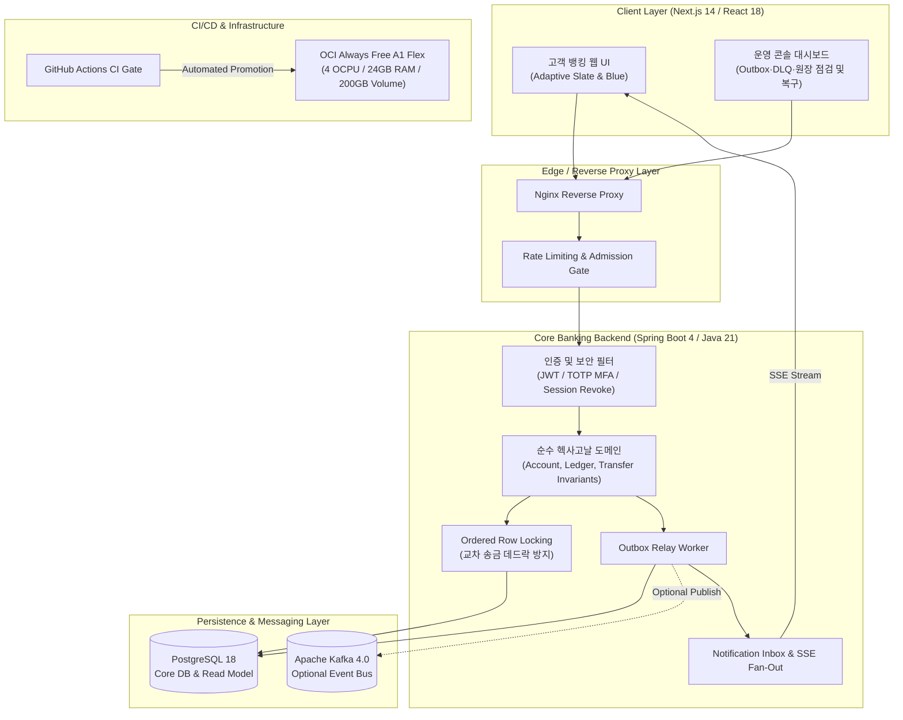
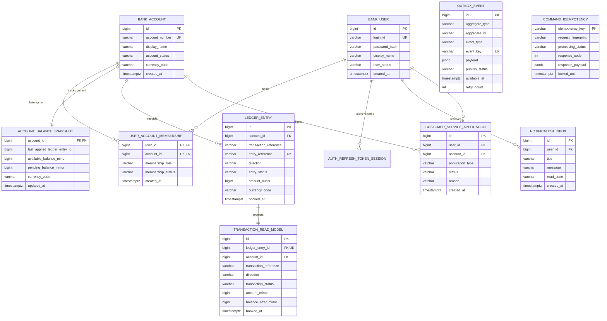

<p align="center">
  
</p>

<h1 align="center">Aquila Bank</h1>

<p align="center">
  <strong>개인 프로젝트 기준의 웹뱅킹 MVP</strong><br>
  내부 계좌 이체, 거래 정합성, 대량 거래 조회, 알림 흐름을 작은 cloud budget 안에서 검증합니다.
</p>

<p align="center">
  <a href="https://github.com/AquilaXk/aquila-bank">
    
  </a>
</p>

<p align="center">
  
  
  
  
  
  
  
</p>

---

## 목차

- [프로젝트 개요](#프로젝트-개요)
- [주요 기능](#주요-기능)
- [시스템 아키텍처](#시스템-아키텍처)
  - [데이터 모델 (ERD)](#데이터-모델-erd)
- [주요 프로세스](#주요-프로세스)
- [기술 스택](#기술-스택)
- [프로젝트 구조](#프로젝트-구조)
- [시작하기](#시작하기)
- [환경 변수](#환경-변수)
- [품질 게이트](#품질-게이트)
- [운영 기준](#운영-기준)
- [트러블슈팅](#트러블슈팅)
- [관련 문서](#관련-문서)
- [프로젝트에서 강조하고 싶은 점](#프로젝트에서-강조하고-싶은-점)

---

## 프로젝트 개요

### 배경

Aquila Bank는 내부 계좌 이체, 원장 정합성, 대량 거래 조회, 실시간 알림이라는 네 가지 핵심 금융 경계를 제한된 클라우드 예산(OCI A1 Flex) 안에서 실증합니다.

| 과제 | 설계 방향 |
| --- | --- |
| 거래 및 원장 정합성 | 잔액 스냅샷, 복식 원장 기록, 감사 추적을 단일 트랜잭션 경계로 묶어 동시성 오류를 차단합니다. |
| 대량 조회 비용 제어 | 1억 건 규모 거래 내역에 대해 계좌·기간·커서 조건을 결합한 Keyset 조회와 타임아웃을 강제합니다. |
| 비동기 알림 신뢰성 | Outbox 적재, 선택적 Kafka 발행, 알림 Inbox, SSE 재연결 복구 경계를 단계별로 분리합니다. |
| 실측 기반 성능 검증 | 성능 개선 여부는 OCI A1 또는 프로덕션에 준하는 환경의 라이브 아티팩트와 메트릭으로 판정합니다. |

### 목표

웹뱅킹 핵심 흐름을 다음 아키텍처 기준으로 설계하고 검증합니다.

| 구분 | 기존 일반적 구성 | Aquila Bank 기준 |
| --- | --- | --- |
| 거래 처리 | API 성공 응답 중심 | 계좌 잔액, 원장, 감사 추적 경계 우선 |
| 거래 조회 | offset/전체 검색 중심 | `accountId + 기간 + keyset pagination` bounded query |
| 알림 | 요청 처리와 강결합 | outbox, Kafka 선택 publish, inbox, SSE fan-out 분리 |
| 운영 검증 | 로컬 테스트 중심 | OCI A1 budget과 live artifact 기준 분리 |

### 핵심 가치

- 거래 정합성 우선: 계좌 잔액, 원장, 감사 추적을 기능 수보다 먼저 둡니다.
- 작은 인프라 기준: OCI A1 Flex 4 OCPU / 24GB + 200GB data volume을 기준 budget으로 둡니다.
- 대량 조회 경계: 계좌, 기간, 커서 기반의 bounded read path와 명시적 타임아웃을 적용합니다.
- 비동기 운영 경계: outbox retry, Kafka publish, notification inbox, SSE replay 경계를 분리합니다.
- 증거 기반 성능 판단: `[Perf]` 주장은 OCI 또는 production-like live artifact가 있을 때만 사용합니다.

공과금, 오픈뱅킹, 인증서, 보안매체 메뉴는 고객 신청 접수부터 운영자 검토·승인·콜백 실행까지의 상태 전이 경계를 다룹니다. 운영자 처리와 callback 샘플은 [Customer Application Mock Webhook](docs/customer-application-mock-webhook.md)에 정리했습니다.

## 주요 기능

| 기능 | 설명 | 기술 포인트 |
| --- | --- | --- |
| 계좌 관리 | 계좌 생성, 상태 관리, 잔액 조회 | 계좌 상태 정책, snapshot 점검/복구, 대표 계좌 및 출금 가능 금액 조회 |
| 내부 이체 | 송금, 사전 검증, 부분 취소, 한도/잔액/상태 검증, 동시 양방향 교차 이체 데드락 방지 | command idempotency, 원장 감사 추적, Ordered Row Locking |
| 거래 조회 | 계좌별 거래 목록과 상세 조회 | keyset pagination, covering index, 명시적 쿼리 타임아웃 |
| 인증/보안 | JWT access token, refresh token session, MFA TOTP | session revoke, backup code, remember device |
| 고객 신청 | 신청 접수, 조회, 취소, 운영자 검토/승인/실행 | 상태 전이 감사, webhook callback 경계 |
| 알림 | 알림 inbox, unread projection, SSE stream | outbox retry, Kafka 선택 publish, replay |
| 운영 도구 | 내부 admin API, 수동 복구 액션, 운영 콘솔 대시보드 | Outbox/DLQ 조회 및 재처리, 멱등성 락 해제, 원장 스냅샷 드리프트 점검, 감사 로그 조회 |

### 화면 구성 및 디자인 시스템

프런트엔드는 라이트/다크 시스템 환경에 자동 대응하는 적응형 컬러 스킴(`color-scheme: light dark`, `light-dark()`), 슬레이트 뉴트럴 서피스(`#F8F9FC` / `#121317`), 시그니처 블루 포인트(`#3279F9`), `1px` 헤어라인 보더, 고정폭 숫자(`tabular-nums`) 기반의 웹뱅킹 인터페이스로 구성되어 있습니다.

| 화면 구분 | 주요 역할 | 세부 기능 및 화면 구성 |
| --- | --- | --- |
| 통합 검색 및 홈 | 메인 허브 및 바로가기 | 대표 계좌 요약, 빠른 이체 금액 입력, 업무 및 메뉴 키워드 실시간 검색 |
| 계좌 조회 | 전계좌 및 잔액 관리 | 보유 계좌 목록, 계좌 상태(정상/한도제한/거래중지), 출금 가능 금액 확인 및 상세 조회 연동 |
| 즉시 이체 | 내부 송금 처리 | 출금/입금 계좌 맞바꿈(Swap), 금액 증분 입력(+1만, +5만, +10만, +100만, 정정), 수취인 확인, OTP 인증 및 이체 완료 내역 출력 |
| 거래내역 조회 | 대량 거래 내역 탐색 | 계좌·기간·상태·금액 조건 필터링, 커서 기반 다음 페이지 연속 조회 |
| 인증센터 | 보안 및 세션 제어 | 활성 로그인 세션 목록, 접속 기기/IP 조회 및 원격 세션 해지, TOTP MFA 등록 및 복구 코드 관리 |
| 고객센터 및 사고신고 | 사고신고 및 신청 관리 | 사고신고 접수 및 처리 상태 추적, 고객 신청 접수와 운영자 검토·승인·실행 상태 확인 |
| 운영 콘솔 | 파이프라인 점검 및 수동 복구 | Outbox 대기열 및 DLQ 이벤트 조회/재처리, 만료된 멱등성 락 해제, 원장 스냅샷 드리프트 점검, 감사 로그 실시간 조회 |

## 시스템 아키텍처



### 데이터 모델 (ERD)



## 주요 프로세스

### 1. 거래 정합성 경계 및 동시성 제어

도메인은 Spring, JPA, web, SDK 구현에 의존하지 않습니다. 송금 흐름은 잔액 검증, 한도 정책, 원장 기록, 감사 추적을 같은 업무 경계로 보고, inbound/outbound adapter는 `global`에 둡니다.

| 설계 원칙 | 내용 |
| --- | --- |
| domain 독립성 | `domain`은 framework/infrastructure 구현에 의존하지 않습니다. |
| 원장 우선 | 송금 결과는 계좌 잔액 스냅샷 갱신과 불변 원장(Ledger Entry) 기록을 단일 트랜잭션으로 묶어 처리합니다. |
| idempotency | 재시도 상황에서 같은 command가 중복 실행되지 않도록 경계를 둡니다. |
| audit trail | 상태 변경과 운영자 조작은 추적 가능한 기록으로 남깁니다. |
| 데드락 방지 (Ordered Row Locking) | 동시 양방향 교차 송금(A→B, B→A) 시 계좌 ID 오름차순으로 balance snapshot 및 계좌 행 락(SELECT FOR UPDATE)을 순차 획득하여 순환 대기 데드락을 차단합니다. |

### 2. 1억 건 거래 조회 경로

온라인 거래 조회는 계좌와 기간, 커서를 결합한 bounded query로 처리합니다.

```text
accountId + date range + status + cursor
        |
        v
covering index / keyset pagination
        |
        v
small page response / timeout / admission control
```

- 전체 1억 건 검색, 집계, 정렬은 온라인 목표에서 제외합니다.
- read model과 원본 거래 데이터는 필요 시 분리 가능한 구조로 둡니다.
- timeout, DB pool, admission control, edge reject curve를 같은 조회 경로의 비용으로 봅니다.

### 3. Outbox와 실시간 알림

쓰기 transaction 안에서 outbox event를 적재하고, worker가 외부 publish/delivery를 분리합니다.

| 단계 | 역할 |
| --- | --- |
| outbox claim | 미발송 event를 작은 batch로 점유하고 재시도 상태를 관리합니다. |
| Kafka publish | Kafka enabled 상태에서는 topic/bootstrap 설정 누락을 startup 실패로 처리합니다. |
| inbox consume | 사용자 알림 inbox와 unread projection을 갱신합니다. |
| SSE fan-out | reconnect gap은 bounded replay와 pull API 재동기화로 보완합니다. |
| DLQ/redrive | 실패 event는 운영 API로 확인하고 재처리 경로를 둡니다. |

### 4. 운영 콘솔 및 수동 복구 경계

운영 콘솔은 내부 관리 API를 통해 비동기 이벤트 파이프라인, 멱등성 락, 원장 스냅샷 드리프트, 감사 로그를 실시간 조회하고 수동 복구 작업을 실행합니다.

- Outbox 및 DLQ 관리: 발송 대기 중인 Outbox 이벤트와 재시도 상한을 초과한 DLQ/격리 이벤트를 조회하고 수동 재처리(Redrive)를 실행합니다.
- 멱등성 락 제어: 비정상 중단된 요청의 만료된(Stale) 멱등성 락 현황을 확인하고 수동 해제를 수행합니다.
- 원장 스냅샷 드리프트 점검: 원장 합산 금액과 계좌 잔액 스냅샷 간의 불일치(Drift) 여부를 조회하고 스냅샷 재계산 복구를 실행합니다.
- 감사 로그 조회: 주요 상태 변경과 운영자 조치 이력을 조건별로 실시간 검색합니다.

### 5. Evidence 기반 성능 판단

성능 개선 PR은 live artifact를 기준으로 판단합니다.

- OCI 또는 production-like 환경에서 실행한 run id, artifact URL, 주요 수치를 남깁니다.
- synthetic fixture pass, mock evidence, harness-only pass는 성능 개선 증거로 보지 않습니다.
- shell script, workflow, evidence harness 수정은 병목 확인을 막는 차단 사유가 있을 때만 최소 범위로 진행합니다.

### 6. 개발 및 운영 워크플로우

```text
Epic -> Sub-Issue -> 격리 브랜치(from main) -> 수직 슬라이스 PR
        |
        v
GitHub Actions CI + 2중 코드리뷰(aquila-review & security-reviewer) -> main 병합
        |
        v
staging 자동 배포 -> production 수동 승격(prod-* 태그) 및 GitHub Release 발행
```

- 도메인 목표 단위의 Epic 아래에 Sub-Issue를 두고, 연관된 변경은 하나의 수직 슬라이스(Vertical Slice) PR로 묶어 발행합니다.
- 모든 PR은 GitHub Actions 품질 게이트와 `aquila-review`(5대 적대적 감사 게이트 + 4-Pass 리뷰) 및 `security-reviewer`(3-Lens 보안 감사) 2중 코드리뷰를 통과하고 미해결 스레드 0건을 확인한 뒤 `main`에 병합합니다.
- `main` 병합 커밋은 staging 환경에 자동 배포되며, 검증이 끝난 동일 SHA만 GitHub Environment 수동 승인 또는 `prod-*` 태그로 승격하고 `.github/release.yml` 기반 GitHub Release를 발행합니다.
- 미완성 기능은 장기 `develop` 브랜치 대신 feature flag로 기본 비노출 처리합니다.

## 기술 스택

| 영역 | 스택 |
| --- | --- |
| Frontend | Next.js 14, React 18, TypeScript, Tailwind CSS, PostCSS, Lucide Icons |
| Backend | Spring Boot 4, Java 21, Spring Security, JDBC, Flyway |
| Data | PostgreSQL 18 |
| Event / Async | Kafka 4.0 (KRaft), Outbox, SSE |
| Edge / Ops | Nginx, Docker Compose, OCI A1 Flex, GitHub Actions |
| Observability / Load Test | Prometheus, Grafana, k6, Postgres exporter, Ops Console Dashboard |
| Quality | Gradle check, Spotless, SpotBugs, JaCoCo, Testcontainers, Playwright E2E, UI Contract Tests, Next lint |

## 프로젝트 구조

```text
.
├── front/                  # Next.js 14 / React 18 frontend
├── back/                   # Spring Boot 4 / Java 21 backend
├── infra/                  # OCI/AWS 선택형 Terraform baseline
├── ops/                    # Nginx, Prometheus, Grafana 운영 baseline
├── tools/                  # test/evidence/ops helper scripts
├── .github/                # issue/PR templates, CI/CD workflows
├── compose.yml             # 로컬 PostgreSQL/Kafka 개발 인프라
├── compose.t3micro.yml     # 작은 CPU/메모리 budget 근사 overlay
└── compose.loadtest.yml    # k6/Prometheus/Grafana 부하테스트 overlay
```

## 시작하기

### 사전 준비

- Java 21
- Node.js LTS
- Yarn Classic
- Docker Compose

### 1. 저장소 클론

```bash
git clone https://github.com/AquilaXk/aquila-bank.git
cd aquila-bank
```

### 2. 로컬 환경 파일 준비

```bash
cp back/.env.example back/.env
cp front/.env.example front/.env.local
```

프런트는 백엔드 API 주소를 `NEXT_PUBLIC_API_BASE_URL`로 받습니다.

```bash
NEXT_PUBLIC_API_BASE_URL=http://localhost:8080
```

### 3. 개발용 인프라 실행

```bash
docker compose up -d postgres kafka
```

- PostgreSQL: `localhost:5432`
- Kafka: `localhost:9092`

### 4. 백엔드 실행

```bash
source back/.env
./back/gradlew -p back bootRun
```

- Backend: `http://localhost:8080`
- Actuator health: `http://localhost:8080/actuator/health`
- Prometheus scrape: `http://localhost:8080/actuator/prometheus`

### 5. 프런트 실행

```bash
yarn --cwd front install
NEXT_PUBLIC_API_BASE_URL=http://localhost:8080 yarn --cwd front dev
```

다른 포트를 쓰려면 `PORT`를 함께 지정합니다.

```bash
NEXT_PUBLIC_API_BASE_URL=http://localhost:8080 PORT=3001 yarn --cwd front dev
```

- Front: `http://localhost:3000`

## 환경 변수

대표 로컬 변수는 `back/.env.example`, `front/.env.example`에 정리되어 있습니다.

| 영역 | 변수 | 설명 |
| --- | --- | --- |
| Frontend | `NEXT_PUBLIC_API_BASE_URL` | 프런트에서 호출할 백엔드 API base URL |
| Database | `DB_HOST`, `DB_PORT`, `DB_NAME`, `DB_USERNAME`, `DB_PASSWORD` | PostgreSQL 연결 정보 |
| Database budget | `DB_POOL_MAX_SIZE`, `DB_STATEMENT_TIMEOUT_MS`, `DB_LOCK_TIMEOUT_MS` | 작은 인프라 기준 pool/timeout 상한 |
| Security | `SECURITY_JWT_SECRET`, `SECURITY_JWT_ISSUER` | JWT 발급과 검증 기준 |
| Bootstrap | `SECURITY_AUTH_BOOTSTRAP_API_ENABLED`, `SECURITY_AUTH_BOOTSTRAP_API_TOKEN` | 로컬 bootstrap API 제어 |
| Outbox/Kafka | `OUTBOX_KAFKA_ENABLED`, `OUTBOX_KAFKA_BOOTSTRAP_SERVERS` | Kafka publish 활성화와 bootstrap server |
| Notification | `NOTIFICATION_INBOX_CONSUMER_ENABLED`, `NOTIFICATION_INBOX_CONSUMER_CONCURRENCY` | 알림 inbox consumer 실행 기준 |

운영 profile은 외부 PostgreSQL 연결을 위해 `DB_URL` 또는 `DB_HOST` 계열 변수를 사용합니다. 자세한 backend runtime 기준은 [back/README.md](back/README.md)를 확인합니다.

## 품질 게이트

### Backend

```bash
./back/gradlew -p back check
```

- 단위/슬라이스 테스트, Testcontainers 통합 테스트, 동시 교차 이체 데드락 방지 검증(`JdbcTransferConcurrencyDeadlockIntegrationTest`), 쿼리 플랜 회귀 게이트, JaCoCo 커버리지, SpotBugs, Spotless 포맷 체크를 포함합니다.
- 같은 워크트리에서 backend 검증을 병렬 실행할 때는 `tools/test/with-resource-lock.sh`로 직렬화합니다.

### Frontend

```bash
yarn --cwd front lint
yarn --cwd front build
```

### Frontend Contract & Visual E2E

```bash
yarn --cwd front test:api-parity
yarn --cwd front test:ui-contract
yarn --cwd front test:login-runtime
yarn --cwd front test:e2e:visual
yarn --cwd front test:e2e:live-artifacts
yarn --cwd front test:e2e:authenticated
```

- 백엔드 OpenAPI 스펙과 프런트엔드 API 클라이언트 간의 패리티(`test:api-parity`), 적응형 디자인 시스템 토큰 및 UI 도메인 계약(`test:ui-contract`), Playwright 기반 반응형 레이아웃 바운더리와 접근성을 결정론적으로 검증합니다.

### Load / Evidence

```bash
docker compose -f compose.yml -f compose.loadtest.yml --profile loadtest up -d
```

- k6, Prometheus, Grafana, Alertmanager, Postgres exporter는 부하테스트/선택 관측 용도입니다.
- 1억 건 primary evidence는 OCI A1 PostgreSQL data volume의 fixture와 cloud/off-host k6 summary로 닫습니다.

## 운영 기준

### Runtime baseline

| 항목 | 기준 |
| --- | --- |
| Database | PostgreSQL 18 |
| Event broker | Kafka 4.0 single-node KRaft broker |
| Primary 100m evidence | OCI A1 Flex 4 OCPU / 24GB + self-managed PostgreSQL 18 + 200GB Block Volume |
| Query/admission budget | OCI A1 4 OCPU / 24GB 기준 작은 CPU/메모리 budget |
| Optional legacy app smoke | EC2 t3.small + gp3 40GiB |

### Environment split

- 로컬 개발: Docker Compose 기반 PostgreSQL/Kafka
- 로컬 small-budget 근사 검증: `compose.t3micro.yml`
- 로컬 HTTP 부하테스트: `compose.loadtest.yml`
- cloud 1억 건 조회 테스트: OCI A1 PostgreSQL fixture + off-host/cloud k6 runner
- 비용형 DB/capacity 기준: [infra/terraform/oci/paid-a1-postgres](infra/terraform/oci/paid-a1-postgres/README.md)
- reverse proxy baseline: [ops/nginx](ops/nginx/README.md)
- monitoring baseline: [ops/prometheus](ops/prometheus/README.md)

## 트러블슈팅

### 로그인 또는 API 호출에서 `Failed to fetch`

| 항목 | 확인 |
| --- | --- |
| 백엔드 상태 | `curl http://localhost:8080/actuator/health` |
| 개발 인프라 | `docker compose up -d postgres kafka`가 먼저 실행됐는지 확인 |
| 프런트 env | `NEXT_PUBLIC_API_BASE_URL=http://localhost:8080` 설정 확인 |
| 단독 프런트 실행 | 백엔드가 없으면 로그인, 계좌, 이체, 고객 신청 API 호출은 실패 안내를 표시 |

### Kafka 알림 경로가 동작하지 않음

| 항목 | 확인 |
| --- | --- |
| broker | `localhost:9092` Kafka healthcheck 상태 |
| outbox publish | `OUTBOX_KAFKA_ENABLED=true` |
| topic 설정 | `OUTBOX_KAFKA_TOPIC_DEFAULT`, transfer topic 변수 |
| inbox consume | `NOTIFICATION_INBOX_CONSUMER_ENABLED=true` |

### 대량 조회 성능 판단

| 항목 | 기준 |
| --- | --- |
| PR 분류 | 실측 라이브 아티팩트가 포함된 개선만 `[Perf]`로 분류하며, 테스트/스크립트 정리는 `[Test]`, `[CI]`, `[Chore]`를 사용 |
| 병목 근거 | 코드 hot path, DB query/index/statistics, runtime/application 설정 중 하나 |
| 증거 | OCI 또는 production-like run id, artifact URL, 주요 수치 |

## 관련 문서

| 문서 | 내용 |
| --- | --- |
| [back/README.md](back/README.md) | 백엔드 도메인/API/운영 상세 |
| [front/README.md](front/README.md) | 프런트 실행과 API 연결 가이드 |
| [Customer Application Mock Webhook](docs/customer-application-mock-webhook.md) | 고객 신청 mock/webhook boundary |
| [OCI A1 PostgreSQL baseline](infra/terraform/oci/paid-a1-postgres/README.md) | 비용형 PostgreSQL baseline |
| [Nginx reverse proxy baseline](ops/nginx/README.md) | edge reverse proxy와 gate 기준 |
| [Prometheus/Grafana baseline](ops/prometheus/README.md) | 관측 asset과 dashboard 기준 |

## 프로젝트에서 강조하고 싶은 점

Aquila Bank는 제한된 클라우드 예산(OCI A1 Flex 4 OCPU / 24GB RAM) 안에서 웹뱅킹 핵심 흐름의 정합성과 대량 조회·알림 경계를 끝까지 검증하는 프로젝트입니다.

기능 수보다 거래/원장 트랜잭션 정합성, Ordered Row Locking 기반 동시성 제어, 1억 건 규모 Keyset 조회 경로, Outbox/SSE 알림 파이프라인, Admission Control, 실측 기반 운영 증거를 일관된 수준으로 관리하는 데 초점을 둡니다. 외부 기관 실연동은 범위 밖에 두고 핵심 금융 도메인 경계에 집중합니다.
